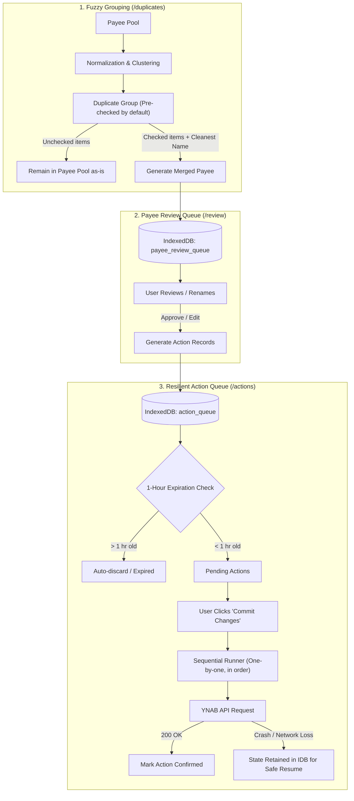

# Plan: Fuzzy Payee Deduplication, Payee Review Queue & Resilient Action Execution

This document details the design and architecture for:
1. Detecting duplicate payees using fuzzy matching with **pre-checked** candidates.
2. Staging combined payees into a **Payee Review Queue** for name review and refinement.
3. Routing all mutations (renames and merges) through a **Persistent Action Queue** in IndexedDB.
4. Executing changes sequentially one-by-one only when the user commits, with crash recovery and automatic 1-hour expiration.

---

## 1. System Architecture & End-to-End Flow



---

## 2. Key Requirements & Architectural Principles

### 2.1 Pre-Checked Candidates & Cleanest Name Selection
- In candidate duplicate groups, all suspected duplicates start **pre-checked**. The user only needs to uncheck false positives.
- Unchecked items immediately return to the regular payee pool untouched.
- Checked items are combined into a proposed payee with the **cleanest name** (e.g. shortest, stripped of transaction noise and trailing store IDs).

### 2.2 Payee Review Queue
- The combined payee is added to a dedicated **Payee Review Queue** (`payee_review_queue` store in IndexedDB).
- This view allows the user to inspect the list of newly proposed payees, tweak their names, or revert them before any API actions are staged.

### 2.3 Persistent Action Queue (`action_queue`)
- **Single Pipeline**: All modifications (merges, reassignments, renames) must be serialized into the local `action_queue`.
- **Deferred Execution**: No API requests are sent when making UI edits. They sit in the queue until the user explicitly clicks **"Commit Changes"**.
- **Sequential In-Order Dispatch**: During execution, actions run strictly one-at-a-time, in the order they were enqueued.
- **Crash Recovery & Resume**:
  - Each action tracks state: `Pending` $\rightarrow$ `InProgress` $\rightarrow$ `Confirmed` / `Failed`.
  - If the browser closes, crashes, or loses connectivity mid-run, unconfirmed actions remain stored in IndexedDB.
  - On restart, the user can review the remaining unconfirmed actions and click "Resume" to continue cleanly from the last unconfirmed action.
- **1-Hour TTL (Automatic Expiration)**:
  - Any queued action with `created_at` older than 1 hour is automatically discarded upon app start or queue reload to prevent desynchronization with YNAB's server state.

---

## 3. Data Models (`src/models.rs`)

### 3.1 Payee Review Queue Item
```rust
#[derive(Debug, Clone, Serialize, Deserialize, PartialEq)]
pub struct PayeeReviewItem {
    pub id: String,                         // Unique ID
    pub suggested_name: String,             // Cleanest name picked
    pub custom_name: Option<String>,        // User-adjusted name
    pub source_payee_ids: Vec<String>,      // IDs of all checked payees combined
    pub source_payee_names: Vec<String>,    // Original names for user reference
    pub created_at: DateTime<Utc>,
}
```

### 3.2 Action Queue Item & Kinds
```rust
#[derive(Debug, Clone, Serialize, Deserialize, PartialEq)]
pub enum ActionStatus {
    Pending,
    InProgress,
    Confirmed,
    Failed { error: String },
}

#[derive(Debug, Clone, Serialize, Deserialize, PartialEq)]
pub enum PayeeActionKind {
    /// Update an existing payee's name (PATCH /v1/budgets/{b}/payees/{id})
    RenamePayee {
        payee_id: String,
        old_name: String,
        new_name: String,
    },
    /// Reassign transactions from old payees to target payee to merge them
    MergePayees {
        target_payee_id: String,
        target_name: String,
        source_payee_ids: Vec<String>,
    },
}

#[derive(Debug, Clone, Serialize, Deserialize, PartialEq)]
pub struct PayeeAction {
    pub id: String,                         // UUID
    pub sequence_number: u64,               // Enforces strict in-order processing
    pub kind: PayeeActionKind,
    pub status: ActionStatus,
    pub created_at: DateTime<Utc>,          // Used for 1-hour expiration
    pub confirmed_at: Option<DateTime<Utc>>,
}
```

---

## 4. IndexedDB Architecture (`src/database.rs` & `src/settings.rs`)

### 4.1 Schema Update (Database Version: `11`)
Bump `DATABASE_VERSION` from `10` to `11`.
Create two new object stores:
1. **`payee_review_queue`**:
   - Primary key: `id`.
   - Index: `created_at`.
2. **`action_queue`**:
   - Primary key: `id`.
   - Indices: `sequence_number` (unique), `status`, `created_at`.

### 4.2 Database Operations
- **`save_review_item` / `get_review_items` / `delete_review_item`**: Manage items awaiting user name confirmation.
- **`enqueue_action` / `get_pending_actions`**:
  - Automatically filters out and deletes items where `created_at < now - 1 hour`.
  - Returns pending actions sorted by `sequence_number ASC`.
- **`update_action_status`**: Marks individual items as `InProgress`, `Confirmed`, or `Failed`.
- **`clear_confirmed_actions`**: Cleans up already confirmed actions after completion.

---

## 5. Execution Runner & Crash Recovery

### 5.1 Sequential Execution Algorithm
```rust
async fn execute_action_queue(db: Arc<idb::Database>, token: String, budget_id: String) {
    // 1. Purge expired actions (> 1 hour old)
    purge_expired_actions(&db).await;

    // 2. Fetch all remaining unconfirmed actions in sequence order
    let actions = get_unconfirmed_actions(&db).await;

    for action in actions {
        // Mark InProgress in IDB before network call
        update_action_status(&db, &action.id, ActionStatus::InProgress).await;

        match dispatch_to_ynab(&action, &token, &budget_id).await {
            Ok(_) => {
                // Confirm in IDB immediately
                update_action_status(&db, &action.id, ActionStatus::Confirmed).await;
            }
            Err(e) => {
                // Mark Failed, stop sequence to prevent cascading inconsistency
                update_action_status(&db, &action.id, ActionStatus::Failed { error: e }).await;
                break;
            }
        }
    }
}
```

### 5.2 Crash Recovery
If the browser is closed or refreshed while action #3 of 10 was in flight:
1. Actions #1 and #2 remain marked as `Confirmed`.
2. Action #3 (or any interrupted item) is flagged as unconfirmed or `InProgress`.
3. The UI warns: *"Previous sync was interrupted. 8 actions pending confirmation."*
4. The user can review the pending list and click **"Resume Sync"**.

---

## 6. UI & Navigation Components

### 6.1 Navigation Routes (`src/main.rs`)
- **`/` — Payees**: Main active payee list from YNAB.
- **`/duplicates` — Find Duplicates**:
  - Group cards with pre-checked candidate payees.
  - Quick action: "Send Cleanest to Review Queue" (unchecked items return to pool).
- **`/review` — Payee Review Queue**:
  - Table of newly proposed combined payees.
  - Inline name editor and "Accept & Queue Action" button (generates `PayeeAction` in `action_queue`).
- **`/actions` — Action Queue & Commit**:
  - Shows total pending actions waiting to be sent to YNAB.
  - Prominent **"Commit Changes"** button with real-time progress bar (e.g. `Action 3 of 7: Renaming 'AMZN' -> 'Amazon'`).
  - Crash resume notice and manual cancel/purge option.
- **`/transactions` — Transactions**: Transaction inspector.

---

## 7. Implementation Roadmap

| Step | Scope | Key Tasks |
|:---|:---|:---|
| **Step 1** | **Models & Dependencies** | Add `strsim = "0.11"`, `uuid = { version = "1.10", features = ["v4", "js"] }` to `Cargo.toml`. Define review queue and action queue structs in `src/models.rs`. |
| **Step 2** | **IndexedDB Upgrade** | Bump database to version `11` in `src/settings.rs`. Add `payee_review_queue` and `action_queue` stores and CRUD functions with 1-hour expiration logic in `src/database.rs`. |
| **Step 3** | **Fuzzy Engine & Cleanest Name Picker** | Implement `src/fuzzy.rs`: token cleaning, Jaro-Winkler metric, clustering, and cleanest canonical name selector. |
| **Step 4** | **Duplicates UI (`/duplicates`)** | Build grouping view with pre-checked candidates, uncheck capability, and "Queue for Review" action. |
| **Step 5** | **Payee Review UI (`/review`)** | Build review screen for inspecting/renaming proposed payees and pushing concrete actions to the Action Queue. |
| **Step 6** | **Action Queue UI & Sequential Runner (`/actions`)** | Build the sequential executor, crash recovery view, real-time progress indicator, and 1-hour expiration handling. |
